# Quick Display - for interactive whiteboards
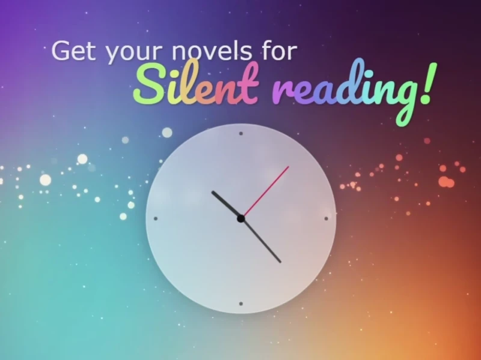

A fast and simple display webapp intended for SMART boards and educational interactive whiteboards - created by Mr L.

Meant for teachers wanting to display notes, gifs, videos, to-do lists, etc. Fast, minimal interface, **RUNS LOCAL-ONLY**, won't bother your school's IT, and guaranteed **COMPLETELY AI-FREE**.

## Getting Quick Display on your SMART Board

[QD is available as a live demo website hosted here on Github.  Click here to open it.](https://maylongweekend.github.io/quickdisplay/)  Once loaded, everything runs locally and no data leaves your computer.

(Alternately, you can download the entire QD code package using the green `Code` button above and choosing `Download ZIP`.  Then double-click on `index.html` to open.)

Once you have QD open in your browser, drag it over to your SMART Board screen and press F11 on your keyboard to go into full screen mode.  Use the right-click menu to add objects, change the background, modify settings, etc.

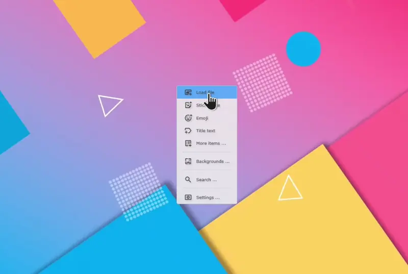

## Adding objects

Right-click on a blank area of the background to add something.  You can load any image, video, or text document using `Load file`.  There are also a number of built-in helpful objects that QD can create.

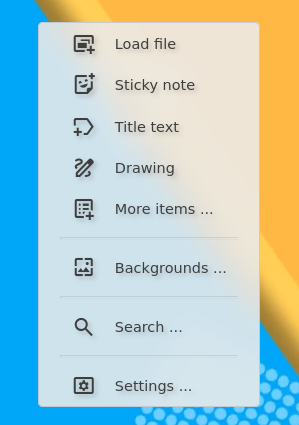 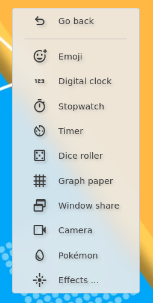

### Drawing

[QD uses Atrament by jakubfiala](https://github.com/jakubfiala/atrament) to handle drawing.  You can choose "Drawing" from the menu or press the `p` button on the keyboard.  Switch back to your mouse with the mouse button or the `m` key on the keyboard.

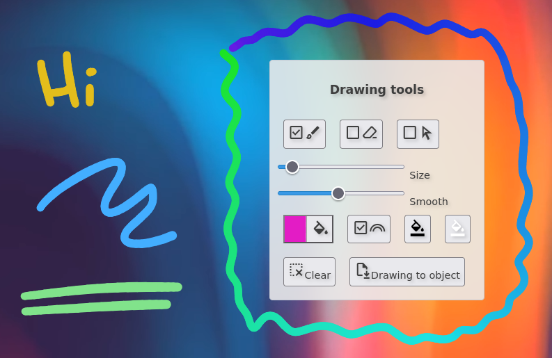

Drawing supports changing colors including a rainbow color effect.  You can also turn your drawing into an interactable image object by choosing the `Drawing to object` option.

### Dice roller

[QD uses 3D Dice Roller by Anton Natarov and sarahRosannaBusch](https://github.com/sarahRosannaBusch/dice) to handle physically-simulated dice.  You can choose what dice you want by clicking the button and entering dice in the format "<#>d<#>" eg `3d6` or `d20 + 3d8` etc.

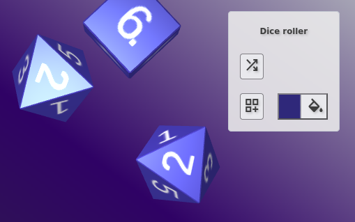

Be aware that the simulated dice can be intensive for weaker computers.

### Pokémon

You can quickly add some favorite Pokémon gifs using this option.  I've only included about seventy of my favorites but let me know if you want any added.

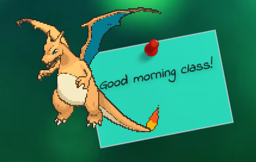

### Effects

[QD uses Sparticles by simeydotme](https://github.com/simeydotme/sparticles) to handle particle effects.  Be aware that particles may be intensive on weaker computers.

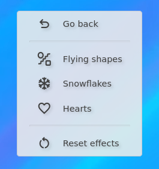

Hearts and snowflakes are built in, and other effects can be created with the `Flying shapes` option.

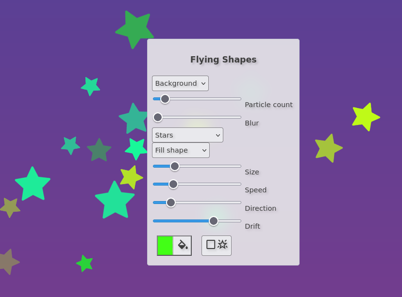

You can reset/delete all particle effects at once with the `Reset effects` button.

## Interacting with objects

Right-click on objects to see options for interacting.  You can also use the scroll-wheel to resize, and click+drag to move items.

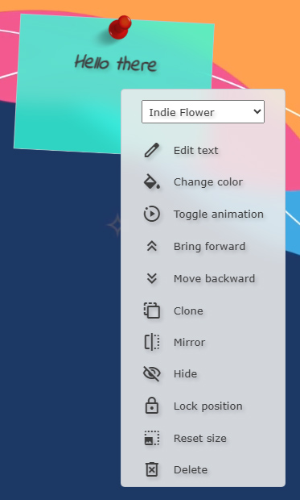

Be aware that cloned objects may be buggy or not have the same interaction options.  They should be used for visuals only.

## Backgrounds

QD supports the use of pictures, videos, and scripts for your wallpaper.  Choose from built-in options or `Load file` to set.  The gradient builder background has further settings available in a settings panel, such as rainbow hue cycling.

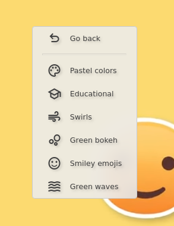 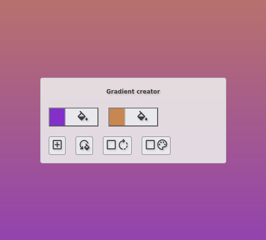

## Pasting

QD supports directly pasting text and image data onto your smartboard with Control + V.  Single-line text will be pasted as a sticky note, multi-line text will become a note, and images will paste as a draggable scalable object.  You can copy/paste transparent layer image data from an editor such as Paint or Photoshop, and its transparency will be preserved.

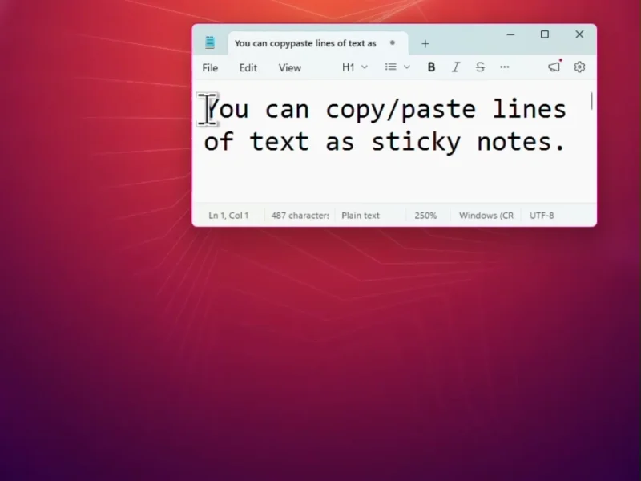

## Quick search options

QD supports quickly searching some popular sites directly from the right-click menu.  You can choose DuckDuckGo's privacy-focused search, Google's web search (AI-free), Youtube search, Google Maps, or Giphy's animated images.

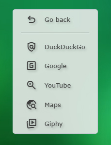

## The Settings menu

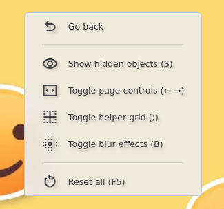

### Hidden objects

You can reveal hidden objects on the current page by pressing the `s` key or choosing `Show hidden options` in the settings menu.

### Page controls

QD supports arranging objects into basic pages.  Use the keyboard arrow keys to move pages, or choose `Toggle page controls` in the Settings menu to show the page control buttons.  Switching pages will slide all objects according to their placement in the page order.  The background of QD will remain unchanged.

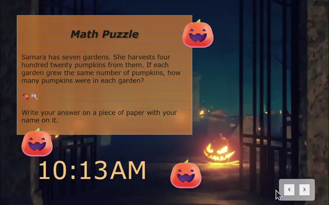

### Helper grid

QD has a simple grid to divide the screen into thirds and sixths, for easier placement.  Press the `semicolon` key or choose `Toggle helper grid` in the settings menu to reveal.

### Blur effects

Many translucent objects in QD can have a visual blur applied behind them.  Because computers at my school are ancient, this effect is disabled by default.  For faster computers, this effect can be enabled with the `b` key or the `Toggle blur effects` option.

## Licensing and credits

You can do what you like with this code as long as:
- you release any derivative works for free
- you in no way use generative AI or large-language models to modify, edit, analyze, train, or otherwise interact with this code
- you are an individual user ONLY

This project makes use of the following libraries; each is the property of their respective authors.

- [jquery](https://jquery.com/) - code formatting
- [Google Fonts](https://fonts.google.com/) - fonts and icons
- [jscolor.js](https://jscolor.com/) - color picker
- [EmojiPicker.js](https://pfurpass.github.io/EmojiPicker/) - emoji picker
- [Sparticles](https://github.com/simeydotme/sparticles) - particle effects
- [3D Dice Roller](https://github.com/sarahRosannaBusch/dice) - dice
- [three.js](https://threejs.org/) - 3D and animated effects
- [Atrament](https://github.com/jakubfiala/atrament) - drawing tools

This project uses the likeness of characters from [Pokémon](https://www.pokemon.com/us), property of Nintendo.  This project uses videos from [Pexels](https://www.pexels.com/search/videos/powerpoint%20background/?resolution_name=1080p&max_duration=60&orientation=landscape) and [Pixabay](https://pixabay.com/videos/search/powerpoint%20background/?orientation=horizontal), under their Free license.

> [!IMPORTANT]
> This software is in no way affiliated with any school division, school authority, provincial or state educational authority, or any other group.  This is the personal project of "Mr L".

> [!NOTE]
> This software is fully free.  If you like what I do and want to support educators and students, consider donating some money to an LGBTQ-friendly organization, such as [Egale Canada](https://egale.ca/donate/).  These organizations make life-saving differences for students with their research and advocacy.
