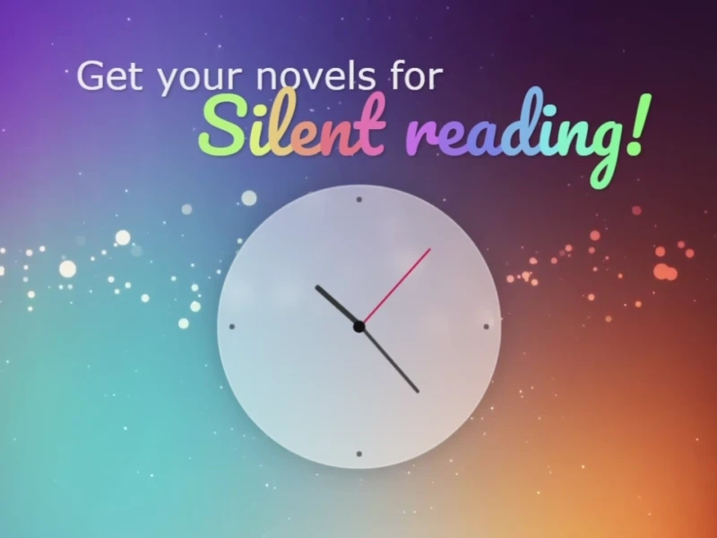
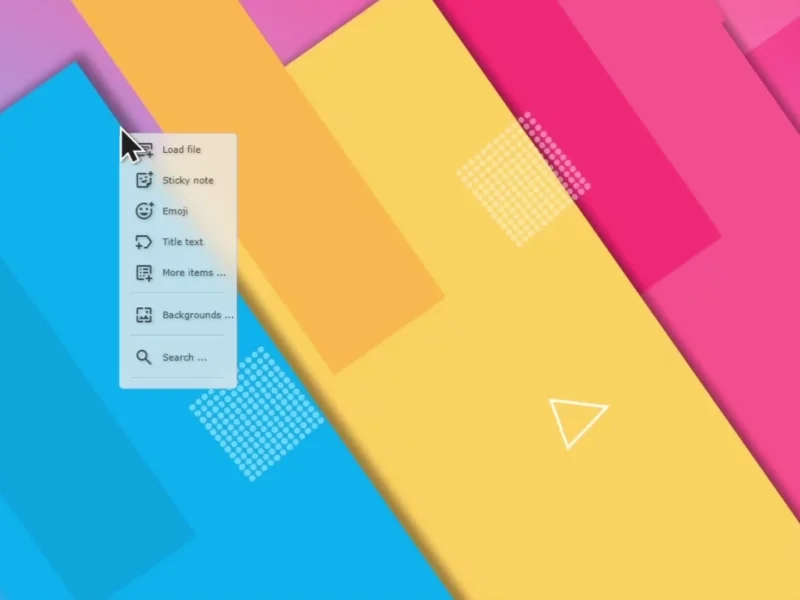
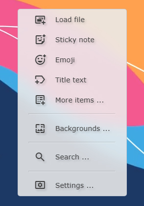
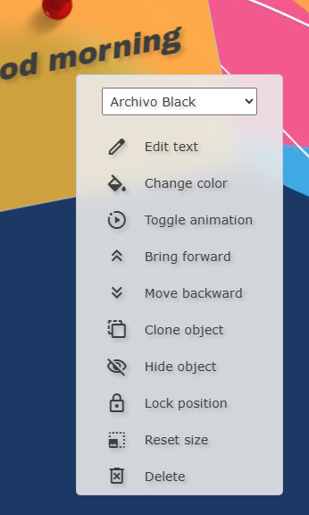
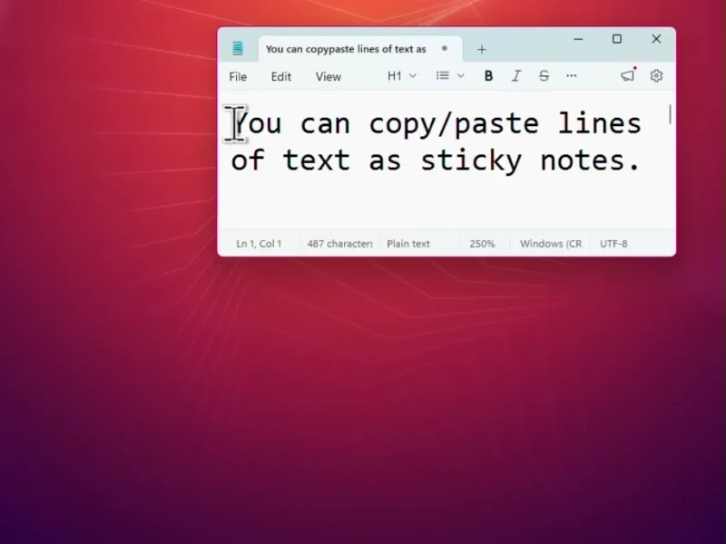
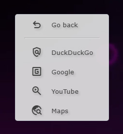

# Quick Display - for interactive whiteboards

A simple display webapp intended for SMART boards and educational interactive whiteboards - created by Mr L

## About

**Quick Display is fast at making pretty and functional classroom displays.**

Meant for teachers wanting to display notes, gifs, clocks, to-do lists, and more on a beautiful background, without ugly user interfaces or visual clutter getting in the way.

QD runs locally, is free and open-source, and shouldn't bother your school's IT person.

> [!IMPORTANT]
> This software is AI-free. Generative "artificial intelligence"/large-language models were not used in any way.

## Getting Quick Display on your SMART Board

[QD is available as a live demo website hosted here on Github.  Click here to open it.](https://maylongweekend.github.io/quickdisplay/)  Once loaded, everything runs locally and no data leaves your computer.

(Alternately, you can download the entire QD code package using the green `Code` button above and choosing `Download ZIP`.)

Once you have QD open in your browser, drag it over to your SMART Board screen and press F11 on your keyboard to go into full screen mode.  Use the right-click menu to add objects, change the background, modify settings, etc.

## Interacting with objects

Right-click on objects to see options for interacting.  You can also use the scroll-wheel to resize, and click+drag to move items.

Be aware that cloned objects may be buggy or not have the same interaction options.  They should be used for visuals only.

## Pasting

QD supports directly pasting text and image data onto your smartboard with Control + V.  Single-line text will be pasted as a sticky note, multi-line text will become a note, and images will paste as a draggable scalable object.  You can copy/paste transparent layer image data from an editor such as Paint or Photoshop, and its transparency will be preserved.

## Quick search options

QD supports quickly searching some popular sites directly from the right-click menu.  You can choose DuckDuckGo's privacy-focused search, Google's web search (AI-free), Youtube search, or Google Maps.

## The Settings menu

### Page controls

QD supports arranging objects into basic pages.  Choose `Toggle page controls` in the Settings menu to show the page control buttons.  Switching pages will slide all objects according to their placement in the page order.  The background of QD will remain unchanged.

> [!NOTE]
> "Pages" work in QD by sliding all objects left or right by the width of your window.  You may experience bugs if you change resolutions.

### Helper grid

QD has a simple grid to divide the screen into thirds and sixths, for easier placement.  Choose `Toggle helper grid` to reveal.

### Blur effects

Many translucent objects in QD can have a visual blur applied behind them.  Because computers at my school are ancient, this effect is disabled by default.  For faster computers, this effect can be enabled with the `Toggle blur effects` option.

## Included resources

If you download the whole source package, there are some helpful tools in the `resources` folder including:

- `clock - analog.js` - an elegant clock face with adjustable transparency.
- `clock - digital.js` - a digital clock with some color/font formatting options.
- `clock - teaching tool.js` - an analog clock with hidden number values that can be revealed to help teach students.
- `graph paper.js` - adjustable grid lines for your smartboard.
- `todo list.js` - a customizable to-do list.  Right-click or click underneath to add a new item.  Click on any time to check it off.  Drag items by the handles to reorder.
- `wallpaper - colors.mjs` - build your own color gradients for your background.  Allows blending with images/videos underneath.

As I update the webapp, more of these resources will become available through the right-click menu.

## Licensing and credits

You can do what you like with this code as long as:
- you release any derivative works for free
- you in no way use generative AI or large-language models to modify, edit, analyze, train, or otherwise interact with this code
- you are an individual user ONLY

This project makes use of the following libraries; each is the property of their respective authors.

- [jquery](https://jquery.com/)
- [Google Fonts](https://fonts.google.com/)
- [anime.js](https://animejs.com/)
- [three.js](https://threejs.org/)
- [EmojiPicker.js](https://pfurpass.github.io/EmojiPicker/)
- [jscolor.js](https://jscolor.com/)

> [!IMPORTANT]
> This software is in no way affiliated with any school division, school authority, provincial or state educational authority, or any other group.  This is the personal project of "Mr L".

> [!NOTE]
> This software is fully free.  If you like what I do and want to support educators and students, consider donating some money to an LGBTQ-friendly organization, such as [Egale Canada](https://egale.ca/donate/).  These organizations make life-saving differences for students with their research and advocacy.
